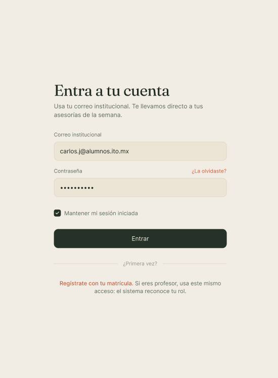
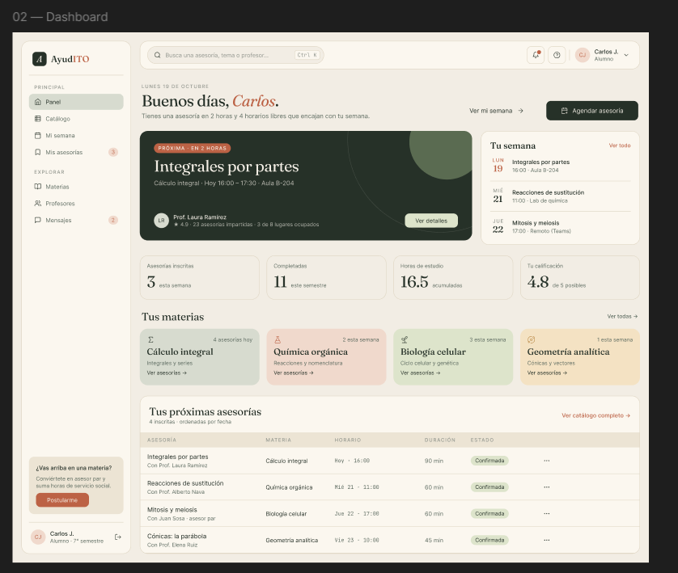
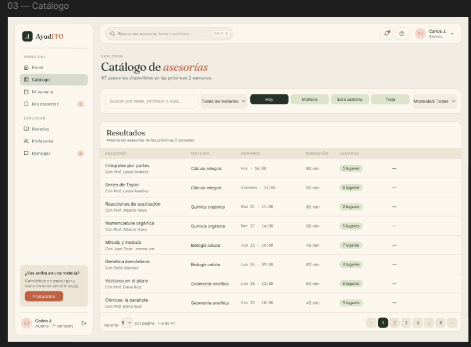

# AyudITO — Plataforma de Asesorías

**Actividad 8 · Equipo 07 (`t3_act8_eq07`)**

Mini sistema en React que simula una plataforma de asesorías: inicio de sesión real contra una API de autenticación, un panel protegido con sidebar y navbar, y una tabla de asesores con filtros, paginación reflejada en la URL y acciones CRUD. Está basado en el mockup de Figma de la Actividad 7.

 **Proyecto desplegado:** http://165.22.188.79/t3_act8_eq07

 **Usuario de prueba:** `emilys` / `emilyspass` (usuario público de DummyJSON; hay más en https://dummyjson.com/users)

---

## Integrantes

| Integrante | GitHub | Partes que desarrolló |
|---|---|---|
| Daniel Juarez | [@DaniielA5](https://github.com/DaniielA5) | Configuración inicial del proyecto, cliente de API (`apiClient`), servicio y hooks de asesores, tabla, filtros, paginación sincronizada con la URL, CRUD, integración y despliegue en el VPS |
| Isaac Emanuel | [@Isaac051225](https://github.com/Isaac051225) | Servicio de autenticación, pantalla de login con validaciones, protección de la vista, Sidebar, Navbar, DashboardPage, componentes UI reutilizables (Modal, ConfirmDialog, Loader, ErrorMessage), variables de estilo del Figma y README |

## APIs utilizadas

Ambas son de [DummyJSON](https://dummyjson.com):

| Uso | Método | Endpoint |
|---|---|---|
| Iniciar sesión | `POST` | `/auth/login` |
| Listar asesores | `GET` | `/users?limit=0&select=firstName,lastName,email,image,university,company` |
| Agregar asesor | `POST` | `/users/add` |
| Editar asesor | `PUT` | `/users/{id}` |
| Eliminar asesor | `DELETE` | `/users/{id}` |

Los usuarios de DummyJSON se muestran como **asesores** de la plataforma: foto, nombre, correo, universidad y área (`company.department`).

> **Nota sobre el CRUD:** DummyJSON *simula* las escrituras (responde como si guardara, pero no persiste). Por eso cada acción hace primero la **petición real** a la API y después refleja el cambio en el **estado local** (`useState`) para que la tabla se actualice. Como la API siempre devuelve el mismo `id` al agregar, a los asesores nuevos se les asigna un `id` local único; y si se edita o elimina uno de ellos, la API responde `404` (porque nunca existió allá), caso que se maneja para que el cambio igual se vea en la tabla.

## Funcionalidades

**Fase 1 — Login**
- Formulario de usuario y contraseña con validación de campos vacíos antes de llamar a la API.
- Mensaje claro si los datos son incorrectos ("Usuario o contraseña incorrectos.") y botón deshabilitado mientras se espera la respuesta.
- Los datos del usuario se guardan en el estado de la aplicación.

**Fase 2 — Sistema protegido**
- Sin sesión solo se muestra el login.
- Sidebar con 3 opciones (Inicio, Asesores y Mis asesorías) y la opción activa resaltada.
- Navbar con la foto y el nombre del usuario, y botón de "Cerrar sesión" que regresa al login.

**Fase 3 — Tabla de asesores**
- Filtro de texto (nombre o correo) y filtro por área.
- Paginación con selector de 10, 20, 40 o 50 registros por página.
- Página, cantidad y filtros reflejados en la URL (por ejemplo `?page=2&limit=20&area=Legal`): el enlace se puede compartir y el botón "atrás" del navegador funciona.
- Indicador de "Cargando..." y mensaje de error con botón para reintentar.
- Agregar, editar y eliminar asesores, con formulario validado y confirmación antes de editar y de eliminar.

**Fase 4 — Despliegue** en un VPS propio (DigitalOcean, Ubuntu 24.04 + Nginx).

## Tecnologías

- React 19 + Vite 8
- React Router 7 (`useSearchParams` para sincronizar la tabla con la URL)
- CSS con variables (paleta y tipografía del Figma)
- ESLint
- Nginx en el VPS

## Estructura del proyecto

```
src/
├── componentes/
│   ├── asesores/   AsesoresTable, AsesoresFilters, Pagination, AsesorForm
│   ├── layout/     Sidebar, Navbar
│   └── ui/         Modal, ConfirmDialog, Loader, ErrorMessage
├── hooks/          useAsesores (datos + CRUD), useTableParams (URL)
├── pages/          LoginPage, DashboardPage, AsesoresPage
├── services/       apiClient, authService, asesoresService
├── styles/         variables.css
├── App.jsx         estado de la sesión y protección de la vista
└── main.jsx        punto de entrada con el router
```

- Las llamadas a la API viven en `services/`; ningún componente usa `fetch` directamente.
- Los componentes de `componentes/` son reutilizables y reciben todo por props.

## Cómo correrlo en local

```bash
git clone https://github.com/DaniielA5/t3_act8_eq07.git
cd t3_act8_eq07
npm install
npm run dev
```

Abrir http://localhost:5173/t3_act8_eq07/

## Despliegue en el VPS

El proyecto se sirve desde la carpeta `/var/www/html/t3_act8_eq07` del servidor, por eso `vite.config.js` tiene `base: '/t3_act8_eq07/'`.

```bash
npm run build
ssh root@165.22.188.79 "rm -rf /var/www/html/t3_act8_eq07"
scp -r dist root@165.22.188.79:/var/www/html/t3_act8_eq07
ssh root@165.22.188.79 "chmod -R u=rwX,go=rX /var/www/html/t3_act8_eq07"
```

## Forma de trabajo

- Cada integrante trabajó en sus propias ramas (`feat/login`, `feat/ui-components`, `feat/layout`, `feat/estilos`, `feat/tabla`, …) con su propio usuario de GitHub.
- Los cambios se integraron a `main` mediante Pull Requests.


## Diseño en Figma

Mockup de la Actividad 7 que sirvió de base para el proyecto: [ver prototipo en Figma] https://www.figma.com/design/Ibm7b85izfPN6iETO4eqrj/Asesorias?node-id=20-111&t=mB07LunZmmz4Kci0-1

### Login
Pantalla de inicio de sesión con usuario y contraseña, siguiendo la paleta del diseño.



### Dashboard
Vista principal con sidebar, navbar con foto y nombre del usuario, y área de contenido.



### Catálogo
Tabla de asesorías con filtros, paginación y controles de acciones.


